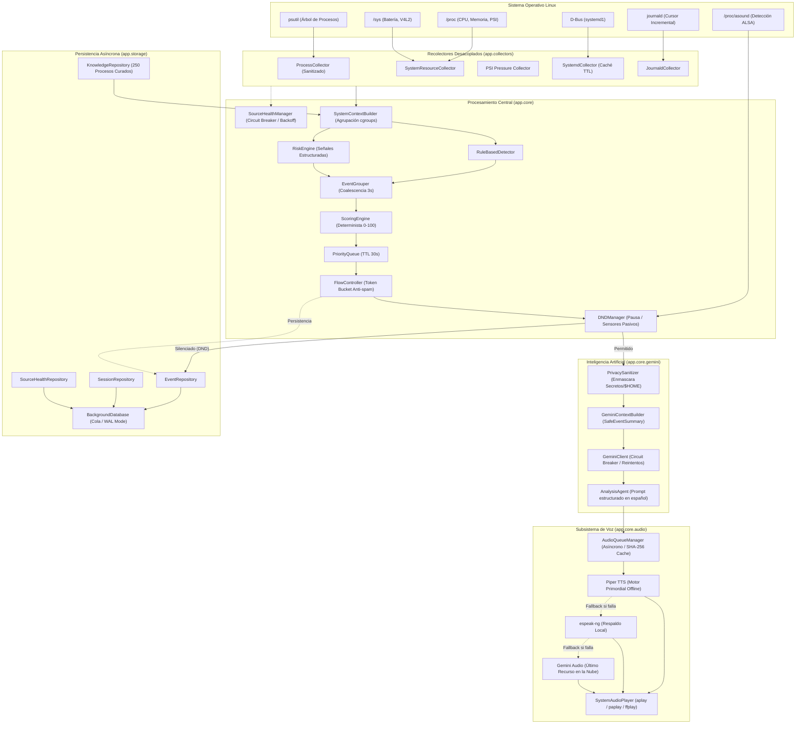

# Arquitectura Técnica y Estructura del Código

Este documento describe la arquitectura modular, los flujos de datos y el diseño interno de **Ubuntu Voice Monitor**.

---

## 1. Diagrama de Arquitectura Global (Mermaid)



---

## 2. Árbol de Directorios del Código Fuente

```
voice-monitor/
├── .github/
│   └── workflows/
│       └── ci.yml                     # Pipeline GitHub Actions (Ubuntu 22.04, 24.04, Debian 12)
├── app/
│   ├── __init__.py                    # Versión 0.1.0 del paquete
│   ├── __main__.py                    # Entry point para `python -m app`
│   ├── cli.py                         # CLI unificado del comando `narrator`
│   ├── main.py                        # Ciclo principal de ejecución
│   ├── collectors/                    # Recolectores no invasivos del sistema
│   │   ├── base.py                    # Interfaz abstracta Collector[T]
│   │   ├── health.py                  # SourceHealthManager (OK, DEGRADED, DISABLED)
│   │   ├── journald.py                # Collector incremental de bitácoras del kernel
│   │   ├── process.py                 # Recolección de procesos con psutil
│   │   ├── procfs.py                  # Lectura eficiente de métricas en /proc
│   │   ├── sanitize.py                # Ocultamiento de contraseñas y tokens en cmdline
│   │   ├── system.py                  # Métricas de CPU, memoria, swap, PSI y batería
│   │   └── systemd.py                 # Integración D-Bus con org.freedesktop.systemd1
│   ├── core/                          # Lógica de negocio y control del flujo
│   │   ├── analysis.py                # AnalysisAgent para estructurar respuestas de IA
│   │   ├── audio/                     # Subsistema de generación y reproducción de voz
│   │   │   ├── adapters/
│   │   │   │   ├── espeak.py          # Adaptador local espeak-ng
│   │   │   │   ├── gemini.py          # Adaptador en la nube Gemini Audio
│   │   │   │   └── piper.py           # Adaptador primordial neuronal Piper TTS
│   │   │   ├── interface.py           # Contratos AudioGenerator y AudioData
│   │   │   ├── manager.py             # AudioQueueManager con cancelación y caché
│   │   │   └── player.py              # SystemAudioPlayer (aplay, paplay, ffplay)
│   │   ├── config.py                  # Settings centralizado inmutable (Pydantic)
│   │   ├── context.py                 # SystemContextBuilder y agrupación por cgroups
│   │   ├── detector.py                # RuleBasedDetector (CPU spikes, presión, etc.)
│   │   ├── dnd.py                     # DNDManager (detección pasiva de micrófono/cámara)
│   │   ├── fixtures.py                # Escenarios sintéticos reproducibles
│   │   ├── flow.py                    # EventGrouper, PriorityQueue y FlowController
│   │   ├── gemini.py                  # GeminiClient, GeminiContextBuilder, CircuitBreaker
│   │   ├── logging.py                 # Configuración de registro y formateadores
│   │   ├── metrics.py                 # PerformanceMetrics (medición de CPU y memoria)
│   │   ├── pipeline.py                # NarrationPipeline integrador
│   │   ├── platform.py                # PlatformDetector (detección WSL vs nativo)
│   │   ├── privacy.py                 # PrivacySanitizer (redacción de credenciales/$HOME)
│   │   ├── replay.py                  # ReplayEngine para sesiones históricas
│   │   ├── reports.py                 # ReportService (generación de HTML y PDF)
│   │   ├── risk.py                    # RiskEngine (señales de OOM, estado D, zombis)
│   │   ├── runtime.py                 # Control de PID files y procesos en segundo plano
│   │   └── scoring.py                 # ScoringEngine explicable y determinista
│   ├── domain/                        # Entidades puras y modelos de datos
│   │   ├── audio.py                   # Modelos de audio y metadatos
│   │   ├── base.py                    # DomainModel inmutable (frozen)
│   │   ├── context.py                 # SystemContext y ApplicationGroup
│   │   ├── enums.py                   # EventSeverity, EventType, EventDecision, etc.
│   │   ├── events.py                  # Event y ScoreResult
│   │   ├── gemini.py                  # SafeEventSummary y GeminiContext
│   │   ├── journald.py                # JournaldSnapshot y JournaldEvent
│   │   ├── knowledge.py               # ProcessKnowledge
│   │   ├── platform.py                # SubsystemStatus y PlatformDiagnostic
│   │   ├── prompts.py                 # Plantillas de prompts en español
│   │   ├── risk.py                    # RiskSignal y RiskCategory
│   │   ├── snapshots.py               # ProcessSnapshot y ResourceSnapshot
│   │   └── systemd.py                 # SystemdSnapshot y SystemdUnit
│   └── storage/                       # Persistencia local y base de conocimiento
│       ├── db.py                      # BackgroundDatabase SQLite asíncrono
│       ├── knowledge_data.json        # 250 firmas curadas de procesos Linux
│       ├── knowledge_data.py          # Cargador tipado de base de conocimientos
│       └── repositories.py            # EventRepository, SessionRepository, etc.
├── docs/                              # Documentación modular complementaria
├── packaging/                         # Empaquetado para distribuciones Linux
│   ├── install.sh                     # Asistente de instalación automática
│   ├── uninstall.sh                   # Script de desinstalación limpia
│   └── systemd/
│       └── voice-monitor.service      # Unidad de servicio systemd de usuario sandboxed
├── scripts/                           # Utilidades de prueba y benchmarks
│   ├── benchmark.py                   # Benchmark de recursos y saturación
│   ├── benchmark_process_collector.py # Benchmark aislado del recolector de procesos
│   ├── demo_pipeline.py               # Demostración del pipeline end-to-end
│   └── test_analysis.py               # Prueba aislada del agente de análisis Gemini
├── tests/                             # Suite de pruebas automatizadas (247 tests)
└── pyproject.toml                     # Metadatos del paquete y dependencias
```

---

## 3. Etapas del Pipeline de Procesamiento

1. **Recolección Aislada:** Cada colector se ejecuta en su propio contexto. Si una fuente falla (por ejemplo D-Bus en WSL), pasa a `DEGRADED` en `SourceHealthManager` y no interrumpe la recolección de CPU o procesos.
2. **Agrupación y Enriquecimiento:** `SystemContextBuilder` asocia los procesos secundarios a su raíz mediante identificadores de cgroup (`/user.slice/app-*.scope`) o inspección jerárquica de árbol.
3. **Detección de Eventos y Señales de Riesgo:** `RuleBasedDetector` y `RiskEngine` generan eventos normalizados con severidad (`INFO`, `LOW`, `MEDIUM`, `HIGH`, `CRITICAL`).
4. **Coalescencia Temporal:** `EventGrouper` retiene eventos durante una ventana de 3 segundos para fusionar eventos repetitivos (ej. picos múltiples de CPU del mismo navegador se consolidan en el más severo).
5. **Puntuación y Priorización:** `ScoringEngine` asigna un puntaje de 0 a 100 evaluando impacto de recursos, novedad, anomalía histórica, riesgo del sistema y penalización por repetición.
6. **Control de Flujo (Anti-spam):** `FlowController` utiliza un token bucket con enfriamiento de 2 s y preemption inmediata para eventos `CRITICAL`.
7. **Modo No Molestar:** `DNDManager` evalúa si el usuario está en videollamada, jugando o si activó pausa. Si DND está activo, el evento se guarda en base de datos con decisión `DND` y no se envía al altavoz.
8. **Sanitización de Privacidad:** `PrivacySanitizer` elimina cualquier dato confidencial antes de enviar el evento a `GeminiContextBuilder`.
9. **Análisis Cognitivo:** Gemini genera una explicación breve y coloquial en español. Si Gemini está desactivado o la red cae, el motor recurre al resumen determinista del evento.
10. **Síntesis y Reproducción de Audio:** `AudioQueueManager` sintetiza la frase usando la cascada de fallbacks (Piper TTS $\to$ espeak $\to$ Gemini Audio) y la reproduce en un hilo independiente sin bloquear el pipeline.
